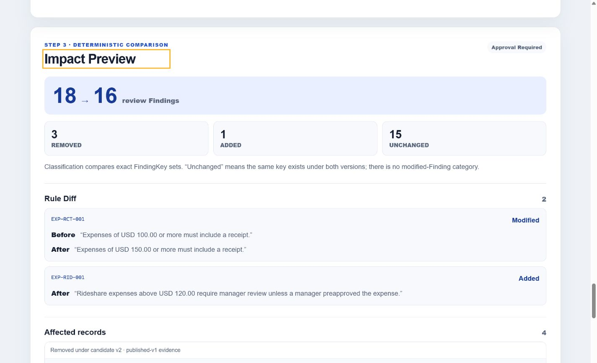
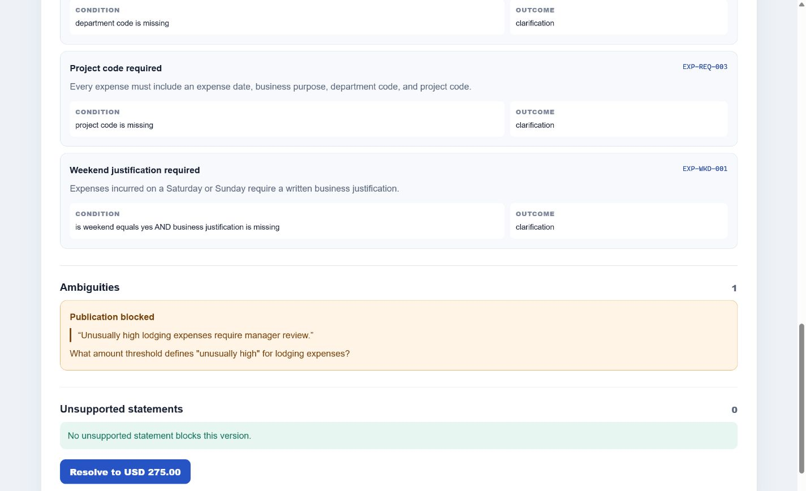
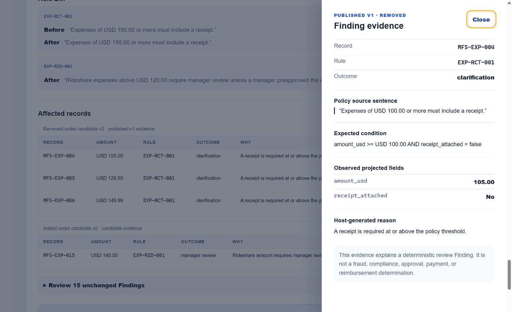
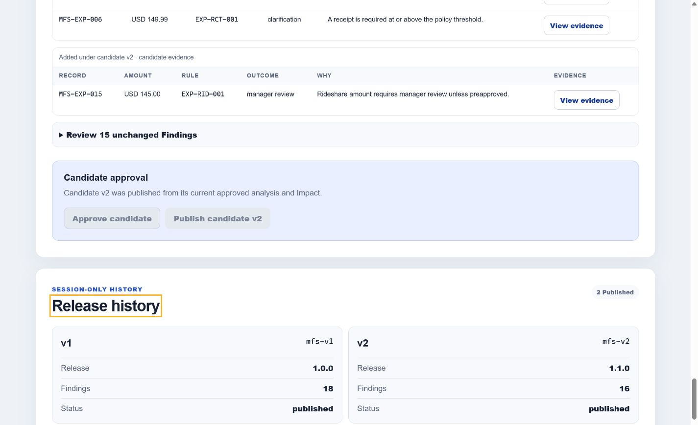

# GovernDiff

> Test policy changes before they ship.

## What GovernDiff does

GovernDiff turns written expense-policy language into a typed, reviewable rule specification, evaluates the same synthetic records against published and candidate policy versions, and shows exactly which review Findings would be added or removed before a policy is published.



## The problem

Policy owners can review wording, but wording alone does not reveal how a change will affect real workflows. A seemingly small threshold change can remove some review Findings, add others, or create an ambiguity that should block publication. GovernDiff makes that effect visible while keeping AI-assisted policy structuring separate from deterministic evaluation.

## Key capabilities

- Blocks publication when the policy contains a supported but unresolved ambiguity.
- Creates an immutable published baseline and a separately reviewed candidate.
- Computes deterministic Findings and an exact Impact Preview over one fixed dataset.
- Shows Rule Diff, affected records, and evidence for removed and added Findings.
- Requires a fresh candidate approval before publishing an immutable v2 release.
- Supports credential-free Sample Mode and optional Live GPT-5.6 Mode.

## Sample Mode

Sample Mode is the default, credential-free demonstration path. Its three analysis assets were captured once with `gpt-5.4`, then human-reviewed, canonicalized, and frozen. The UI always labels these results as precomputed.

Sample analysis makes no request to `/api/analyze` or OpenAI. The compiler, policy runtime, Findings, Impact Preview, Evidence, approval guards, and release history all run locally from committed synthetic data. Sample provenance does not impersonate or replace Live GPT-5.6.

## Live GPT-5.6 Mode

Live Mode uses exact `gpt-5.6` through the OpenAI Responses API and `responses.parse`. The request uses strict Structured Outputs, reasoning effort `low`, `store: false`, zero SDK retries, and a server-only `OPENAI_API_KEY`.

GPT-5.6 structures policy text only. The server validates the model output against strict schemas, the host rule registry, exact source quotes, and canonical variant rules before returning a specification. CSV records, employee data, Findings, Impact, Evidence, approvals, and releases are not sent to OpenAI.

A bounded route-level smoke completed exactly three canonical GPT-5.6 requests successfully—draft, baseline v1, and candidate v2—with zero retries and no fourth request.

## Why GPT-5.6 is meaningful

Natural-language policy is the uncertain input to this system. GPT-5.6 converts that language into a constrained candidate structure that a human can review and the host can validate. It does not decide whether an expense is approved, reimbursed, fraudulent, legal, or compliant. Deterministic TypeScript remains responsible for evaluating records and comparing policy versions.

## How Codex accelerated the workflow

Codex was the primary engineering collaborator from requirements reconciliation through the final privacy review. It accelerated work by keeping each gate small, executable, and independently reviewable:

| Workstream | Codex contribution | Resulting evidence |
|---|---|---|
| Contract design | Reconciled requirements into exact TypeScript contracts, canonical counts, and file-scoped plans. | Stable 5/6/7-rule and 18→16 expectations. |
| Deterministic core | Implemented and reviewed the compiler, policy runtime, Findings, Rule Diff, Impact, and immutable releases. | Pure local evaluation over all 48 synthetic records. |
| State safety | Added revision-bound approval, stale-response rejection, abort handling, and reset invariants. | Focused reducer/controller tests and fail-closed transitions. |
| AI boundary | Built the strict server analyzer, Responses API route, browser client, and canonical host validation. | GPT-5.6 structures text; it never evaluates expense records. |
| Verification | Repeated strict reviews, privacy audits, mocked Live workflows, and full validation at every gate. | Audited Gate 3 baseline: 18 test files and 180 passing tests. |

The key decisions remained human-controlled: use AI only for constrained language structuring; keep record evaluation deterministic; never send expense data to the provider; distinguish frozen GPT-5.4 Sample provenance from Live GPT-5.6; reject noncanonical model output; and require current-revision approval before immutable publication.

## Product walkthrough

The ambiguous draft is blocked until a human supplies the missing lodging threshold:



Evidence connects an affected Finding to its synthetic record, observed fields, expected condition, host-generated reason, and exact policy source:



Publishing preserves the immutable v1 and v2 release history:



## Architecture

```text
Next.js Server Component
  -> verified synthetic scenario + Live availability boolean
Client workspace
  -> one reducer and one request-sequencing controller
  -> Sample analyzer or same-origin Live client
POST /api/analyze
  -> server-only Live analyzer -> OpenAI Responses API
Strict compiler and canonical validator
  -> local policy runtime -> Findings -> Impact engine
  -> immutable in-session v1/v2 release history
```

The browser never imports the OpenAI SDK or receives the API key. Live failures remain Live failures; GovernDiff never silently substitutes a Sample result. Switching modes is an explicit user action that resets the demo session.

## Data and privacy boundary

Live outbound dynamic data is limited to the built-in synthetic policy text and target version. Static developer instructions, a field catalog, and a rule catalog accompany it.

GovernDiff does not send CSV bytes, expense rows or identifiers, employee identifiers or emails, Findings, Impact, Evidence, approval state, or release history to OpenAI. Live route and browser responses use no-store behavior, and the application adds no database, local storage, authentication, analytics, or external business action.

`store: false` is the Responses API request-storage setting. It is not a promise of zero provider-side operational retention, abuse monitoring, or prompt caching.

## Prerequisites

- Node.js `>=24.18.0 <25`
- pnpm `11.6.0`
- Git

Check the active versions:

```powershell
node --version
pnpm --version
```

## Install

From a clean clone:

```powershell
git clone https://github.com/Daiki9801/governdiff.git
cd governdiff
pnpm install --frozen-lockfile
```

## Run without an API key

The application builds and runs without an API key. Start the local development server:

```powershell
pnpm dev
```

Open `http://localhost:3000` and use Sample Mode. Live Mode is visibly unavailable when the server process has no key; Sample Mode remains fully functional and does not call the application analysis route.

If port 3000 is busy, choose another local port explicitly:

```powershell
pnpm exec next dev --port 3107
```

Stop the server with `Ctrl+C`.

## Run with a server-side API key

Live Mode is optional. Prompt for the key interactively so its value is not written into source or shell history:

```powershell
$liveKey = Read-Host "OpenAI API key" -AsSecureString
$liveCredential = [System.Management.Automation.PSCredential]::new(
  "OpenAI",
  $liveKey
)
$env:OPENAI_API_KEY = $liveCredential.GetNetworkCredential().Password
Remove-Variable liveKey, liveCredential
pnpm dev
```

The variable exists only in that PowerShell process and child processes. Do not use `.env.local`, do not expose a browser-readable `NEXT_PUBLIC_OPENAI_API_KEY`, and never commit the key.

After stopping the server with `Ctrl+C`, clear process-scoped variables without printing them:

```powershell
Remove-Item Env:OPENAI_API_KEY -ErrorAction SilentlyContinue
Remove-Item Env:PORT -ErrorAction SilentlyContinue
```

## Complete demo flow

1. Analyze the ambiguous draft: five rules and one blocking lodging ambiguity.
2. Resolve the ambiguity with the explicit USD 275 threshold and re-analyze.
3. Publish immutable baseline `mfs-v1`: six rules and 18 Findings.
4. Start candidate v2, raise the receipt threshold to USD 150, and add the rideshare rule.
5. Analyze the candidate: seven rules and 16 Findings.
6. Compute Impact: 3 removed, 1 added, and 15 unchanged Findings.
7. Inspect Rule Diff, affected records, and removed/added Evidence.
8. Approve the current candidate and publish immutable `mfs-v2` while v1 remains unchanged.

## Validation and tests

Run the complete local validation pipeline:

```powershell
pnpm check
```

`pnpm check` runs lint, strict type checking, Vitest, and the production build. The audited Gate 3 baseline passed 18 test files and 180 tests; later changes may increase that count.

## Canonical expected results

| Stage | Rules | Blocking ambiguities | Findings |
|---|---:|---:|---:|
| Ambiguous draft | 5 | 1 | Not publishable |
| Published baseline v1 | 6 | 0 | 18 |
| Candidate / published v2 | 7 | 0 | 16 |

Impact Preview:

```text
removed: 3
added: 1
unchanged: 15
```

The built-in fixture contains 48 expense records, 12 reports, and 8 synthetic employees.

## Security model

- The API key is server-only and optional.
- Requests are strict two-field, size-limited, same-origin JSON requests.
- Model output is untrusted until schema, registry, source-quote, compiler, and canonical checks pass.
- Abort and request-sequence guards prevent stale analysis from becoming current.
- Live errors expose safe typed messages and never trigger automatic Sample fallback.
- Published releases are immutable in session; candidate edits clear stale approval and Impact.
- No secret, raw model response, request identifier, or token usage is rendered by the UI.

## Limitations

- Local-only demonstration; deployment is not provided.
- Fixed Mavrenna synthetic expense-policy vocabulary and dataset only.
- No arbitrary CSV or policy upload.
- No database, persistence, authentication, multi-user access, rollback, or external action.
- No legal, tax, accounting, fraud, compliance, expense-approval, payment, or reimbursement determination.
- Live Mode requires separately supplied OpenAI API access and may fail closed on unavailable or invalid model output.

## Synthetic-data disclosure

Mavrenna Field Systems is a fictional demonstration company. All policies, employees, expense records, identifiers, and displayed business data are fictional and synthetic. Synthetic employee emails use the reserved `example.invalid` domain. GovernDiff has no affiliation with a real company named Mavrenna Field Systems.

## Repository status

Product implementation Gates 0 through 3 are complete. This public repository contains the credential-free Sample flow, optional Live GPT-5.6 integration, reviewed screenshot assets, the 180-test audited baseline, and an MIT license. Demo-video hosting and final Devpost submission remain human-owned delivery steps.

## License

Licensed under the MIT License. See [LICENSE](LICENSE).

## OpenAI Build Week

GovernDiff was built as a solo Work and Productivity project for OpenAI Build Week. Codex was the primary engineering collaborator for typed contracts, the deterministic engine, state-transition guards, boundary tests, the Live adapter, and repeated strict reviews. GPT-5.6 is used meaningfully inside the product to structure policy language while deterministic local code remains responsible for impact evaluation.
